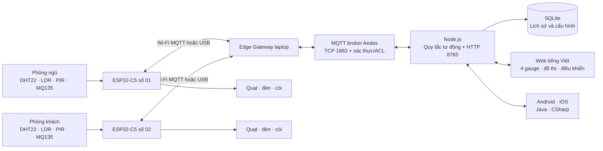
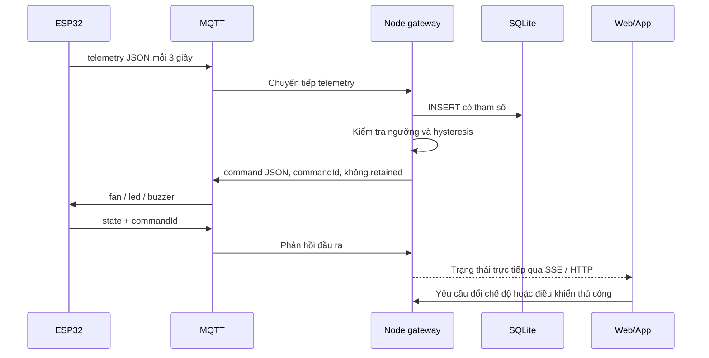

# Kiến trúc phòng ở thông minh

Với đường Wi-Fi, ESP32 nối trực tiếp MQTT broker; gateway ứng dụng Node.js nhận topic và ghi SQLite/API. Với đường USB, chương trình gateway-usb chuyển JSON serial thành MQTT và chuyển command về board. Không bật cả hai đường cho cùng ID trong cùng thời điểm.

## Luồng đo và điều khiển

## Cấu hình và phục hồi

ESP32 giữ AP cấu hình và web 192.168.4.1. Preferences/NVS lưu Wi-Fi, broker, ID, transport, demo/sensor và điểm hiệu chuẩn. Nếu router đổi hoặc thông tin sai, người dùng vào lại AP để sửa. Lệnh có thời hạn, còi giới hạn thời gian phát, mất gateway không duy trì đầu ra vô hạn.

Một bộ ESP32 hiện có chỉ chứng minh được một nút vật lý. Hai MQTT simulator chứng minh luồng nhiều node và tách dữ liệu; không thay thế minh chứng hai board thật.
